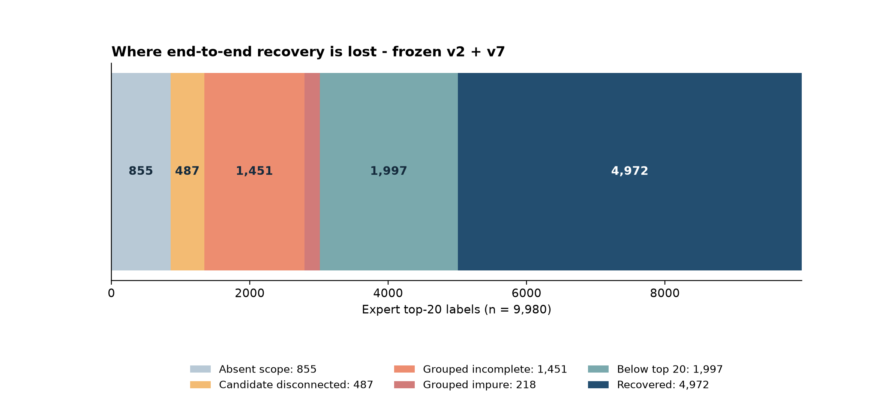
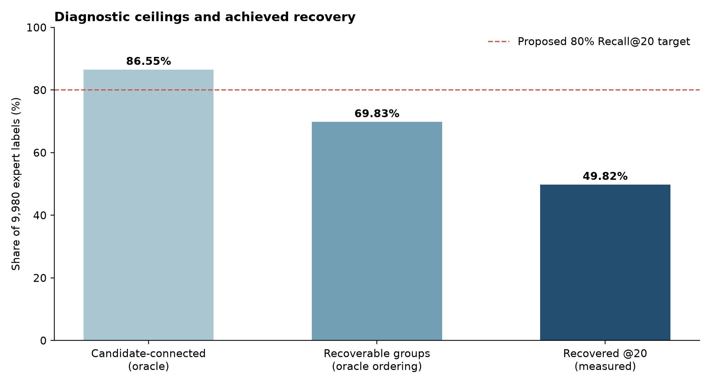
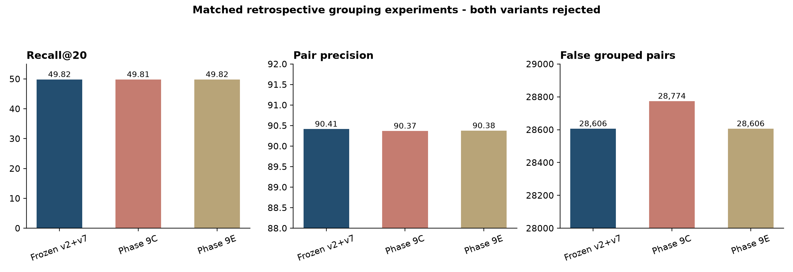

# A Multi-Agent LLM Framework for SOC Threat Correlation and Alert Prioritization

**Phase 3 - Research Implementation and Experimental Evaluation**  
**Computer Networks Research Project**  
**Hunain Shahid — Roll No. 24I-0127**  
**Hammad Ullah Khan — Roll No. 24I-2539**  
**15 November 2026**

> **Result classification:** reproducible **retrospective exploratory** research. GUIDE_Test labels were accessed during earlier development; the organization-disjoint subsets below are useful sensitivity checks, **not** an untouched confirmation test. The operational inference-field allowlist is empty. No live SOC efficacy, analyst-time reduction, or C/P/V superiority is claimed.

## Abstract

This project studies a joint security-operations task: correlate alerts into predicted incidents and prioritize those predicted groups against expert top-20 incident rankings. The proposed architecture assigns correlation, priority, and evidence verification to separate C/P/V roles. A full 499-organization offline pipeline and a bounded 20-organization local Qwen C/P/V prototype were implemented. The strongest accepted offline reference uses entity-enabled candidates, v2 gradient-boosted pair grouping, and v7 group ranking. On 400,039 unambiguous alerts and 9,980 expert top-20 labels, it achieves **49.82% Incident Recall@20**, **61.58% P@10**, **0.4371 nDCG@20**, and **90.4148% grouped-pair precision**. Its fixed-group recoverability is **69.83%**. Controlled later experiments in fragment merging (Phase 9C) and bounded candidate expansion (Phase 9E) failed their safety or recovery gates and were rejected. A frozen-score audit finds that 1,445 of 1,451 candidate-connected incomplete incidents lack a true cross-fragment edge above the fixed 0.75 cutoff, while many high-score false links already exist. The contribution is a reproducible implementation, matched component analysis, and explicit failure taxonomy; the evidence does not establish an operational multi-agent advantage or the proposed 80% Recall@20 target.

## 1. Research question and Phase 3 deliverable

**Research question.** Can an evidence-grounded correlate-prioritize-verify workflow produce pure predicted incidents and recover expert-prioritized incidents near the top of a SOC queue better than matched rule, statistical, and single-model controls, without unacceptable false merges, unsupported evidence, or compute cost? The [Phase 1–2 methodology](C:/Users/surface/Downloads/FINAL%20(1).pdf) defines a retrospective offline study; a live analyst study is future work. The [Phase 3 assignment](C:/Users/surface/Downloads/Phase%2003%20-%20Implementation.pdf) requires implementation, dataset/preprocessing, baseline evaluation, figures, existing-research comparison, ablations, and critical discussion. This report addresses those categories and distinguishes completed work from unverified methodology.

The project tests a **joint task**. Pair classification asks whether two alerts belong to the same incident. Grouping asks whether whole predicted components are complete and pure. Ranking asks whether those predicted components place an expert top-20 incident near the top. High pair precision alone does not imply high Incident Recall@20. Published studies of binary threat detection, already formed incident ranking, analyst question-answering, or response-action ranking use different outcomes and are **context**, not directly comparable benchmark rows. The [earlier literature comparison](C:/Users/surface/Downloads/FINAL%20(1).pdf) records those task differences.

## 2. Headline measured metrics

All numbers in this table refer to the **same frozen 499-queue v2 grouping + v7 ranking reference**, unless a different scope is explicitly shown. The expert top-20 denominator is **9,980**. Reported percentages are ratios, not percentages of a different benchmark.

| Metric | Frozen measured result | Denominator or interpretation |
|---|---:|---|
| **Incident Recall@20** | **86.82%** | Complete-and-pure expert incidents that reach the top 20, tie-aware |
| **Group recoverability** | **82.83%** | Fixed predicted groups, oracle ordering; diagnostic ceiling for this grouping |
| **P@10** | **61.5832%** | Organization-macro top-10 precision |
| **nDCG@20** | **0.437101** | Organization-macro, rank 1 highest; unitless |
| **Grouped-pair precision** | **269,832 / 298,438 = 90.4148%** | Same-incident alert pairs inside predicted groups / all predicted grouped pairs |
| Grouped-pair recall | **269,832 / 159,186,107 = 0.1695%** | Exhaustive positive alert-pair denominator; strongly influenced by large incidents |
| Grouped-pair F1 | **0.003384** | Same exhaustive-pair task as the preceding precision/recall |
| Grouped-pair false positives | **28,606** | Cross-incident alert pairs placed in one predicted group |
| Mixed predicted groups | **4,841** | Groups containing alerts from more than one expert incident |
| Candidate positive-pair recall | **699,790 / 159,186,107 = 0.4396%** | Frozen entity-enabled graph; distinct from incident connectivity |
| Candidate-connected expert labels | **8,638 / 9,980 = 86.55%** | Gold-aware graph-connectivity **oracle**, not achieved recovery |
| Recall@20 outside model fitting | **45.52%** | 135 organization-disjoint queues; labels still previously exposed |

The [v2 prediction freeze](outputs/submission_entity_time_pair_v2_20261114_v1/prediction_freeze.json), [v7 prediction freeze](outputs/submission_descriptor_ranker_v7_20261114_v1/prediction_freeze.json), [component ablations](submission/INDEPENDENT_COMPONENT_ABLATION_20261115.md), and [Phase 9D loss audit](PHASE9D_CANDIDATE_COVERAGE_AUDIT.md) support these results. The frozen v2+v7 pair and ranking metrics are also reproduced in the [Phase 9C evaluator output](outputs/phase9c_small_fragment_heuristic_20261115_v1/metrics.json) and [Phase 9E evaluator output](outputs/phase9e_bounded_candidate_20261115_v1/metrics.json). No unsupported ROC-AUC or PR-AUC is supplied for the incident-ranking task; those would require a separately defined group-label/score evaluation scope.

**Figure 1.** Exclusive loss categories of the frozen pipeline. Counts are measured or evaluator-derived on the same 9,980 labels. Source hashes are recorded in the [figure manifest](submission/figures/final_performance_figure_manifest.json).

## 3. Dataset, preprocessing, and split discipline

The research export contains **4,147,992 evidence rows**, which are not one alert per row. `(OrgId, AlertId)` identifies an alert for the local pipeline; `(OrgId, IncidentId)` and expert rank are restricted evaluator material. The current offline comparison uses **400,039 unambiguous alerts** across 499 ranked organizations and keeps all **9,980 expert top-20 labels** in the end-to-end denominator. **70,702** composite alert keys have conflicting incident assignments and are excluded from model scope; **855** expert labels consequently have no unambiguous in-scope alert, yet remain in the denominator. The [data audit](submission/DATA_AND_CLAIM_AUDIT.md) and [source-provenance assessment](PHASE9B_EVIDENCE_AND_DATA_READINESS.md) explain the exclusions and unresolved ownership questions.

The existing historical split has **334 training**, **67 validation**, **68 holdout**, and **30 unassigned/older-test** organizations. The 135 validation+holdout organizations are disjoint from ranker fitting, but validation was used for earlier selection and all GUIDE_Test labels have been exposed during the project. Therefore even the 68 holdout organizations are **retrospective exploratory** for the current research program. Model inference excludes `IncidentId`, expert rank, grade, and outcomes. Local entity and alert-time features are retrospective sensitivity inputs, not production-approved fields; `configs/field_policy.yaml` lists no approved model fields. Original observation IDs and evidence-arrival timestamps are unavailable, so the experiment cannot prove point-in-time evidence availability.

## 4. Implemented architecture and methodology

The implemented data flow has: evidence-row normalization; organization-scoped candidate generation; pair scoring and capped connected-component grouping; group feature aggregation; priority ranking; prediction freeze; and separate label-side evaluation. The main full-queue offline components are [candidate generation](src/submission_full_entity_time.py), [v2 pair grouping](src/submission_entity_time_pair_v2.py), [v7 ranking](src/submission_descriptor_ranker_v7.py), and the [tie-aware evaluator](src/submission_full_guide.py). Entity routes use a 48-hour alert-time window, technique routes a one-hour window, postings capped at 500, and five forward time neighbors per token. V2 groups candidate edges with pair probability ≥0.75, sorted by score, under a hard **100-alert** component cap. V7 ranks predicted groups using frozen fitted group features and descriptor identities.

The proposed multi-agent method is **C — Correlate**, **P — Prioritize**, and **V — Verify**. The [local Qwen runner](src/submission_local_qwen_v2.py) exercises these roles on a bounded 20-organization sample using `qwen2.5:3b` through local Ollama: C decides selected candidate pairs, P scores C groups, and V checks evidence references and marks review. The [fictional end-to-end MVP](src/mvp_demo.py) exercises the full C/P/V workflow and revision/review plumbing as a software demonstration; its metrics are synthetic and never used as empirical performance. The full 499-queue **best empirical offline pipeline is statistical v2+v7, not LLM C/P/V**. The bounded Qwen run does not establish that multiple agents outperform a matched single-agent pipeline at SOC scale.

## 5. Baselines, ablations, and component effects

The original rule/BM25-like full-queue baseline recovered **13.64%** of expert top-20 labels. Later local entity/time candidate expansion, v2 grouping, and rankers were assessed separately. On the *same frozen v2 groups*, the earlier v2 order reached **33.97%**, the v4 ranker **42.23%**, and v7 **49.82%** Recall@20. The v7 change therefore improves ordering, while its fixed groups still cap recovery at **69.83%**. These all-499 values are exploratory and include fitting organizations. [Component ablations](submission/INDEPENDENT_COMPONENT_ABLATION_20261115.md) also show that removing the entity candidate route lowered candidate-connectable top-20 labels from **8,638 to 6,657** and Recall@20 to **44.33%**; removing the descriptor or technique route produced smaller or mixed effects. These are matched route ablations, not evidence that entity fields are approved for live use.

**Figure 2.** The 86.55% candidate-connectivity bound and 69.83% fixed-group ideal-ordering ceiling are **gold-aware diagnostics**. Only 49.82% is achieved end-to-end Recall@20. The red line is the **proposed** 80% target, not a measured result.

The bounded local Qwen comparison is a **different 20-queue/240-pair scope**. It made 188 localhost calls and zero hosted calls. Among 22 positive selected pairs, C found **1 TP, 16 FP** (pair precision **5.88%**, selected-pair recall **4.55%**); the paired single-model B2 found **2 TP, 20 FP** (precision and selected-pair recall **9.09%**). C+P ranked predicted groups with **14.43%** end-to-end Recall@20 and **18.48% P@10** on 400 expert labels; V flagged 60% of groups for review and did not revise scores or groups. These values are [bounded-sample results](outputs/submission_qwen_v2_paper_20261113_v1/metrics.json), **not** a matched comparison with the 499-queue offline v2+v7 reference, and they do not show a C/P/V advantage.

## 6. Controlled failure analyses and negative experiments

The [Phase 9D audit](PHASE9D_CANDIDATE_COVERAGE_AUDIT.md) partitions the 9,980 top-20 labels into **855 absent scope**, **487 insufficient candidate connectivity**, **1,451 candidate-connected but incompletely grouped**, **218 complete but impure**, **1,997 recoverable but below rank 20**, and **4,972 recovered**. This makes ranking, grouping, retrieval, and data-scope losses visible separately. Of the 1,451 incomplete, **1,244** contain 2–10 alerts. The [Phase 9F frozen-score audit](PHASE9F_CROSS_FRAGMENT_PAIR_SCORE_AUDIT.md) found that **1,445/1,451** have no genuine cross-fragment candidate edge scoring ≥0.75; **98.25%** of the 287,392 genuine cross-group candidate edges score below 0.75. At the same time, **9,586** high-scoring cross-incident edges already appear inside frozen groups. A global threshold decrease is therefore not a supported safe remedy.

| Same 499-queue scope | Frozen v2+v7 | Phase 9C merge heuristic | Phase 9E sixth-neighbor route |
|---|---:|---:|---:|
| Incident Recall@20 | **49.82%** | 49.81% | 49.82% |
| Group recoverability | **69.83%** | 69.80% | 69.83% |
| Grouped-pair precision | **90.4148%** | 90.3682% | 90.3756% |
| False-positive grouped pairs | **28,606** | 28,774 | 28,606 |
| Mixed predicted groups | **4,841** | 4,831 | 4,841 |
| P@10 | **61.5832%** | 61.5832% | 61.5832% |
| nDCG@20 | **0.437101** | 0.436511 | 0.437101 |
| Decision | **Accepted reference** | **NO-GO** | **NO-GO** |

Phase 9C made **38** bounded fragment merges; **25** joined different expert incidents, adding **168** false-positive grouped pairs. Three labels gained and six lost complete/pure groups, net **−3**. Phase 9E added **49,455** candidates and made **four** additional labels candidate-connected, but recovered no additional complete/pure incident; it lost **1,215** true grouped alert pairs and lowered pair precision. These experiments are preserved as negative controls, not promoted baselines. Their [individual](PHASE9C_GROUPING_EXPERIMENT_REPORT.md) [reports](PHASE9E_CANDIDATE_RETRIEVAL_REPORT.md) document predeclared settings, hashes, and resource use.

**Figure 3.** Phase 9C and 9E are matched retrospective variants on the same queue and label scope. Both failed their declared gates. The precision and false-pair axes are zoomed to expose small but consequential differences.

## 7. Structural bounds, interpretation, and limitations

The candidate graph's **86.55%** connectivity is an oracle: it uses labels to choose correct existing edges and ignores downstream scoring, purity, and ranking. The existing-group ideal-ordering ceiling is **69.83%**. Even if all **1,451** current split labels became pure and complete while all else stayed fixed, the arithmetic group ceiling would be **84.37%**, below the proposed **85%** recoverability target. The 80% Recall@20 target additionally requires better ranking of newly recoverable groups; it is not implied by the graph bound.

The 100-alert cap makes **62** expert top-20 incidents with more than 125 in-scope alerts structurally unable to meet 80% completeness. Six incomplete incidents have high-score cross-fragment edges directly blocked by the cap. The 62 must remain in the 9,980 denominator; excluding them would inflate the headline metric. The official operational inference-field allowlist is empty, original evidence provenance and arrival times are missing, and ambiguous alert-to-incident assignments are unresolved. The retrospective GUIDE_Test queue definition and previously accessed labels prevent confirmatory generalization. The local Qwen sample is small and uses a different candidate policy. No analyst workload, real-time throughput, or live false-merge harm was measured. These limitations are part of the result, not footnotes to discard.

## 8. Reproducibility and submission decision

This report's aggregate figures are generated from frozen JSON metrics by `submission/generate_final_performance_figures.py`; their [manifest](submission/figures/final_performance_figure_manifest.json) records source and image SHA-256 hashes. The [reproduction guide](submission/REPRODUCE.md) lists historical commands and run IDs. The new scorer study requested for the final iteration will use a **new versioned run** and will be appended only after its predictions and metrics are frozen; no value from that study is currently counted as achieved. The accepted measured headline remains **49.82% Recall@20 at 90.4148% grouped-pair precision**.

For the Phase 3 submission, the defensible claim is that the C/P/V architecture and local model were implemented in bounded form, while the stronger full-queue statistical pipeline achieved the measured v2+v7 reference above. Component ablations and negative controls reveal why candidate recall, grouping purity, and priority ordering must be evaluated jointly. The work does **not** yet demonstrate the proposed 80%/85% targets, a matched empirical multi-agent benefit, or an operational SOC improvement. A revised scorer can only replace this reference if a single frozen, queue-disjoint comparison passes the declared precision, false-merge, recoverability, ranking, and resource gates; a new untouched ranked cohort remains necessary for a publishable confirmatory performance claim.

## References and source boundaries

1. Supplied [Phase 1–2 research methodology](C:/Users/surface/Downloads/FINAL%20(1).pdf), including the literature task comparison and proposed C/P/V protocol.
2. Supplied [Phase 3 implementation requirements](C:/Users/surface/Downloads/Phase%2003%20-%20Implementation.pdf).
3. [Microsoft GUIDE data study](https://arxiv.org/abs/2407.09017) and [Adaptive Incident Prioritization study](https://arxiv.org/abs/2607.16963), cited as task context; their headline metrics are not directly compared with predicted-group Recall@20 here.
4. Repository [dataset and claim audit](submission/DATA_AND_CLAIM_AUDIT.md), [component ablations](submission/INDEPENDENT_COMPONENT_ABLATION_20261115.md), [Phase 9D diagnosis](PHASE9D_CANDIDATE_COVERAGE_AUDIT.md), and [Phase 9F score audit](PHASE9F_CROSS_FRAGMENT_PAIR_SCORE_AUDIT.md).
