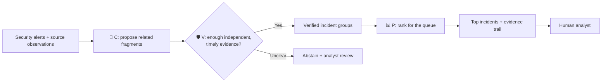

<div align="center">

# 🛡️ SOC Alert Correlation & Incident Prioritization

### From a flood of alerts to an evidence-backed incident queue

[](#project-status)
[](#best-confirmed-experiment-phase-33)
[](#best-confirmed-experiment-phase-33)
[](#project-status)

**Correlate → Verify → Prioritize → Analyst review**

[Explore the workflow](#how-the-system-works) · [See the best result](#best-confirmed-experiment-phase-33) · [Browse the research](#research-history-and-decisions) · [Check readiness](#project-status)

</div>

---

## At a glance

| 🧩 What it does | 🏆 Best confirmed result | 🔒 Safety on that holdout | 🚦 Real-world status |
|---|---|---|---|
| Proposes incidents from alerts, checks the links, then ranks the groups for an analyst | **260/300 incidents recalled** in the top 20 on a fresh controlled synthetic holdout | **0 false grouped pairs; 0 mixed groups** under simulator truth | **Not evaluated** on a qualified real SOC export; shadow deployment **NO-GO** |

> [!IMPORTANT]
> The **86.67%** result is from an untouched **synthetic** Phase 33 holdout. It is not a measured real-world SOC result or a claim about autonomous multi-agent performance.

---

## Start here

| If you want to… | Open… |
|---|---|
| Understand the product and the C/P/V roles | [What this project is building](#what-this-project-is-building) · [How the system works](#how-the-system-works) |
| Inspect the strongest experiment | [Phase 33 result](#best-confirmed-experiment-phase-33) · [full report](experiments/PHASE33_FROZEN_GENERALIZATION/PHASE33_FINAL_REPORT.md) |
| See what has been implemented | [Built components](#what-has-been-built) · [repository guide](#repository-guide) |
| Follow every major decision, including NO-GOs | [Research history](#research-history-and-decisions) · [experiment archive](experiments) |
| See what blocks real-world use | [Project status](#project-status) · [Phase 39 readiness report](experiments/PHASE39_REAL_SOC_VALIDATION/PHASE39_FINAL_REPORT.md) |

---

## What this project is building

The intended product is an analyst-facing incident queue. It would turn many security alerts into proposed incidents, check whether the links have independent supporting evidence, and rank the incidents that deserve attention first. Each proposal should show its supporting records and any missing or contradictory evidence. Uncertain relationships go to human review; the system does not automatically contain threats or force unsupported merges.

The current implementation is an **offline research system**, not a live SOC application. Its best measured pipeline uses deterministic code. The repository also contains C/P/V agent workflow scaffolding and bounded local-model experiments, but the Phase 33 result **does not measure three autonomous AI agents or an LLM C/P/V system**.

## How the system works



**C/P/V in plain language:** **C** proposes which alerts belong together; **V** checks the proposed links against original evidence and abstains when proof is insufficient; **P** orders the resulting groups for analysts. Verification happens **before final ranking** in the Phase 33 implementation. The letters also name agent roles in earlier workflow prototypes; the measured Phase 33 pipeline is deterministic.

## What has been built

| Area | Implemented work | Status |
|---|---|---|
| Real-data intake | Microsoft GUIDE schema and key validation, preprocessing, label isolation, ambiguous-alert audit, historical exploratory baselines and ranking studies | The local file contains 4,147,992 **evidence rows**, not 4.1 million independent alerts. Its labels were used in earlier exploratory work. [Data audit](submission/DATA_AND_CLAIM_AUDIT.md) |
| C/P/V workflow research | Candidate generation, correlation/prioritization/verification interfaces, synthetic checks, local Qwen experiments, matched offline controls, and reproducibility reports | Useful prototypes and exploratory results; no confirmed full multi-agent superiority. [Historical report](FINAL_RESEARCH_PERFORMANCE_REPORT.md) · [reproduction guide](submission/REPRODUCE.md) |
| Controlled SOC simulator | Separate receiver-visible and evaluator-only data; process, authentication and network observations; independent and shared roots; duplicates, missing/delayed evidence, contradictory and false claims | Enables controlled safety and recall studies, but simulator truth cannot establish real-world sensor independence. [Phase 31](experiments/PHASE31_CONTROLLED_SOC_EVIDENCE/PHASE31_FINAL_REPORT.md) |
| Frozen C/P/V pipeline | Correlate related alert fragments; verify proposed unions against provenance, causal fields and a decision-time cutoff; rank verified groups | Phase 33 uses [Phase 16 correlation](experiments/PHASE16_PROVENANCE_RECONSTRUCTION/v4/predict.py), [Phase 31 evidence validation](experiments/PHASE31_CONTROLLED_SOC_EVIDENCE/model.py), and the [Phase 32 endpoint fallback and ranking](experiments/PHASE32_SAFE_EVIDENCE_RECOVERY/model.py). In code, verification occurs before final ranking. |
| Evaluation and audits | Official top-20 evaluator, matched baseline comparisons, queue-level safety checks, prediction seals, hashes, split isolation and post-evaluation truth audits | The [original evaluator](experiments/PHASE15_CONTROLLED_SOC/evaluation/evaluate.py) is unchanged for the Phase 33 result. |
| External-data readiness | Local/public data source review, frozen-model schema comparison, authorization, provenance and temporal audits, and an export specification | Phase 39 stopped **before real-data prediction**. [Readiness report](experiments/PHASE39_REAL_SOC_VALIDATION/PHASE39_FINAL_REPORT.md) |

## Best confirmed experiment: Phase 33

The Phase 32 `endpoint_fallback_bonus1` candidate was frozen, then run once on a new 15-queue synthetic holdout alongside the frozen Phase 31 baseline. Both saw the same eligible alerts. Predictions were sealed before evaluator-only truth was opened.

```text
Matched baseline   █████████████████░░░  83.33%  (250/300)
Frozen candidate   █████████████████▓░░  86.67%  (260/300)  +10 incidents
```

*The bars compare only the two arms on the same Phase 33 holdout.*

| Metric | Matched baseline | Frozen candidate | Meaning |
|---|---:|---:|---|
| Incident Recall@20 | 250/300 (83.33%) | **260/300 (86.67%)** | Priority incidents correctly retrieved within the first 20 groups; **+10 on the same cohort** |
| Group recoverability | 263/300 (87.67%) | **281/300 (93.67%)** | Priority incidents for which at least one sufficiently complete and pure group exists |
| P@10 | 107/150 (71.33%) | **113/150 (75.33%)** | Top-ten priorities found in the first ten groups across 15 queues |
| Grouped-pair precision | 100% | **100%** | All grouped alert pairs were correct under simulator truth |
| False grouped pairs / mixed groups | 0 / 0 | **0 / 0** | No false merge observed in this holdout |

All **28 new fallback unions** were genuine under simulator truth. Phase 33 passed its **synthetic** research gate; this is not a real SOC or production-safety claim. The exact metrics, queue audit, code/configuration hashes and limitations are in the [Phase 33 report](experiments/PHASE33_FROZEN_GENERALIZATION/PHASE33_FINAL_REPORT.md) and [holdout summary](experiments/PHASE33_FROZEN_GENERALIZATION/HOLDOUT_SUMMARY.json).

The evaluator credits a priority incident only when a predicted group contains **at least 80% of that incident's eligible alerts**, at least **80% of the group** belongs to it, and the group appears in the first 20. P@10 uses the first ten groups. These definitions and denominators are not changed between matched arms.

## Research history and decisions

These percentages come from **different populations** unless a matched baseline is shown in the same row or report. They are not one continuous performance curve.

**The short story:** GUIDE established the first exploratory workflow → safety studies exposed false-merge risks → richer controlled evidence enabled Phase 33's confirmed synthetic result → later ranking ideas did not clear their gates → Phase 39 found that available real data cannot yet support the frozen verifier.

<details>
<summary><strong>📚 Expand the phase-by-phase research record</strong></summary>

<br/>

| Work | Result or decision | What it established |
|---|---|---|
| [Initial GUIDE research](FINAL_RESEARCH_PERFORMANCE_REPORT.md) and [24-hour sprint](FINAL_24H_EXPERIMENT_REPORT.md) | Best validation-selected exploratory GUIDE ranking: **50.77% Recall@20** on 499 organization queues | Built real-data validation and exploratory grouping/ranking studies. GUIDE labels were previously accessed; this is **not** a confirmatory Phase 33 comparison. |
| [Phase 16](experiments/PHASE16_PROVENANCE_RECONSTRUCTION/PHASE16_FINAL_REPORT.md) and later `source_depth` experiment | Historical selected synthetic reference **407/600 (67.83%)**; later experimental holdout **444/600 (74.00%)** with a P@10 regression | Established a grouping/ranking reference and exposed the tradeoff between recall and early-queue quality. |
| [Phases 17–23](experiments/PHASE22_RECEIPT_ROBUSTNESS/PHASE22_FINAL_REPORT.md) | Safety investigations; Phase 22 showed two receipts can share a corrupted upstream source | Led to explicit trust-domain and common-mode checks. These were research findings, not a promotion. |
| [Phases 24–30](experiments/PHASE30_SAFE_RECALL_IMPROVEMENT/PHASE30_FINAL_REPORT.md) | Recall and reconstruction studies; Phase 30 found a **77.67% development recoverability ceiling** and zero safe new unions | Ranking alone could not overcome missing cross-fragment evidence in that cohort. |
| [Phase 31](experiments/PHASE31_CONTROLLED_SOC_EVIDENCE/PHASE31_FINAL_REPORT.md) | **158/200 (79.0%) development Recall@20** on a richer synthetic cohort | Added controlled process, identity and network evidence; not directly comparable with earlier populations. |
| [Phase 32](experiments/PHASE32_SAFE_EVIDENCE_RECOVERY/PHASE32_FINAL_REPORT.md) | **169/200 (84.5%) development Recall@20** | Developed the conservative endpoint fallback +1 candidate; remained development-only. |
| [Phase 33](experiments/PHASE33_FROZEN_GENERALIZATION/PHASE33_FINAL_REPORT.md) | **260/300 (86.67%) untouched synthetic holdout**, with zero false pairs/mixed groups | Strongest confirmed synthetic generalization result; matched baseline was 250/300. |
| [Phase 34](experiments/PHASE34_FROZEN_RANK_GENERALIZATION/PHASE34_FINAL_REPORT.md) | **267/300 (89.0%) development-only** | Narrow ranking gain, but missed its 90% gate; no holdout. |
| [Phase 35](experiments/PHASE35_NEAR_BOUNDARY_RANKING/PHASE35_FINAL_REPORT.md) | **258/300 (86.0%) development-only** | Pairwise near-boundary ranker matched its baseline and failed the gate. |
| [Phase 36](experiments/PHASE36_EVIDENCE_AWARE_RECALL/PHASE36_FINAL_REPORT.md) | **262/300 (87.33%) development-only**, versus matched baseline 265/300 | Evidence-aware ranker regressed on recall without changing grouping safety. |
| [Phase 37](experiments/PHASE37_EVIDENCE_AVAILABILITY_RESEARCH/PHASE37_FINAL_REPORT.md) | Reconstruction **NO-GO** | Delayed/missing/correlated telemetry stress tests showed an evidence dependency; no new independent source justified a safe reconstruction rule. |
| [Phase 38](experiments/PHASE38_INTEGRATED_RECALL_OPTIMIZATION/PHASE38_FINAL_REPORT.md) | **262/300 (87.33%) development-only**, versus matched baseline 263/300 | Hard-negative ranking failed the 90% gate; no holdout. |
| [Phase 39](experiments/PHASE39_REAL_SOC_VALIDATION/PHASE39_FINAL_REPORT.md) | **Real-world Recall@20 not measured; shadow readiness NO-GO** | Audited available data and specified the authorized export needed for a fair external test. |

All phase artifacts and negative results remain in `experiments/`. Historical reports such as [CONTEXT.md](CONTEXT.md) and [PROJECT_ITERATIONS.md](PROJECT_ITERATIONS.md) document the earlier GUIDE work; the Phase 33–39 reports above govern the later synthetic and external-readiness claims.

</details>

## Project status

| Gate | Status | Evidence |
|---|:---:|---|
| Fresh synthetic holdout | ✅ Passed | [Phase 33](experiments/PHASE33_FROZEN_GENERALIZATION/PHASE33_FINAL_REPORT.md) |
| Synthetic false-merge checks | ✅ Passed | 0 false grouped pairs and 0 mixed groups on Phase 33 |
| Qualified real SOC export | ⏳ Needed | [Data acquisition specification](experiments/PHASE39_REAL_SOC_VALIDATION/DATA_ACQUISITION_SPEC.md) |
| Real-world Recall@20 | — | Not measured |
| Shadow deployment | 🚫 NO-GO | [Readiness assessment](experiments/PHASE39_REAL_SOC_VALIDATION/SHADOW_READINESS_ASSESSMENT.md) |

<details>
<summary><strong>🔎 Why real-world validation is blocked</strong></summary>

<br/>

The local GUIDE file is a real-world research release, but it does not contain the frozen verifier's **original source-observation IDs, upstream trust roots, derivation links, causal process/authentication/network receipts, or evidence-arrival times**. The local audit found **70,702 composite alert keys with conflicting incident assignments**. The ranking file's exact queue scope and judgment completeness remain unresolved. The official real-data field policy currently approves **no model-visible fields**. It would be invalid to fill those gaps from shared host/account values or evaluator labels.

Phase 39 therefore produced **no real-data predictions or metrics**. The next milestone is an authorized, evaluation-ready SOC export with original observations and timestamps, independently adjudicated incident membership and priority, explicit queue snapshots, and approved field use. See the [data acquisition specification](experiments/PHASE39_REAL_SOC_VALIDATION/DATA_ACQUISITION_SPEC.md), [schema comparison](experiments/PHASE39_REAL_SOC_VALIDATION/DATASET_SCHEMA.md), and [shadow-readiness assessment](experiments/PHASE39_REAL_SOC_VALIDATION/SHADOW_READINESS_ASSESSMENT.md). The frozen Phase 32 verifier should remain unchanged for this test.

</details>

## Repository guide

| Path | Contents |
|---|---|
| [`src/`](src) and [`configs/`](configs) | GUIDE validation, preprocessing, exploratory runners, workflow scaffolding and field policies |
| [`data/raw/`](data/raw) and [`data/derived/`](data/derived) | Local GUIDE inputs and audit/derived artifacts; raw data is not a model-ready Phase 33 cohort |
| [`experiments/`](experiments) | Controlled synthetic generators, frozen models, phase plans, predictions, evaluations and safety audits |
| [`experiments/PHASE33_FROZEN_GENERALIZATION/`](experiments/PHASE33_FROZEN_GENERALIZATION) | Best confirmed synthetic holdout, exact result and integrity artifacts |
| [`experiments/PHASE39_REAL_SOC_VALIDATION/`](experiments/PHASE39_REAL_SOC_VALIDATION) | External-source register, schema/authorization audits and export requirements; **no result CSVs** |
| [`submission/`](submission) and [`outputs/`](outputs) | Historical exploratory GUIDE studies, reports, figures and immutable run outputs |

## Inspect the recorded work

Use Python 3.12 from the repository root. These commands **verify existing files**; they do not run a new model evaluation:

```powershell
python experiments/PHASE39_REAL_SOC_VALIDATION/audit_local_sources.py
Get-Content experiments/PHASE33_FROZEN_GENERALIZATION/HOLDOUT_SUMMARY.json
Get-Content experiments/PHASE33_FROZEN_GENERALIZATION/POST_EVALUATION_AUDIT.json
```

The Phase 33 prediction runner is intentionally single-use and refuses to overwrite its recorded outputs. The earlier GUIDE workflow has a separate [reproduction guide](submission/REPRODUCE.md) and uses distinct cohorts and assumptions.

**Research prototype only.** No live SOC deployment, automatic incident merge, automatic response action, verified analyst productivity gain, or measured real-world Recall@20 is claimed.
