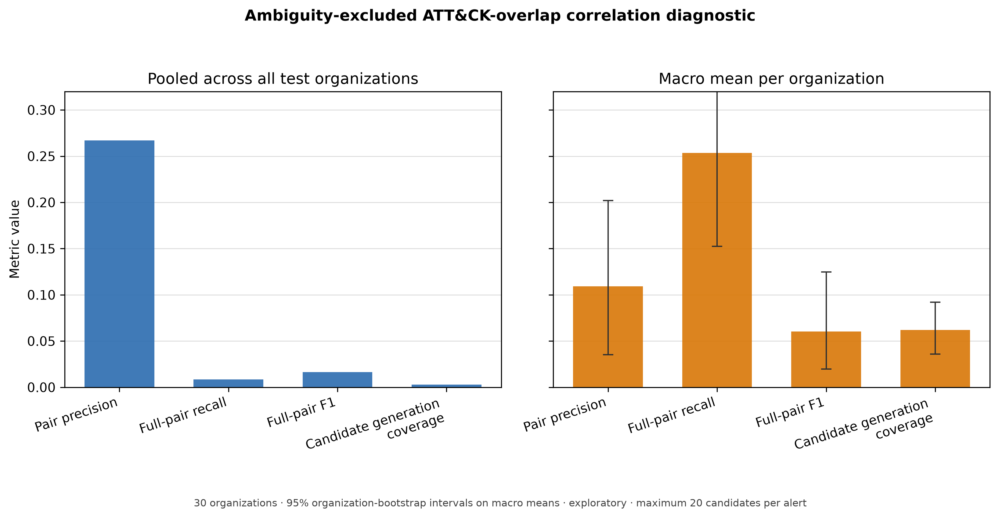

# Phase 6 correlation diagnostic — corrected aggregate metrics

**Classification:** `exploratory_ambiguity_excluded_correlation_metric_report_correction`  
**Organizations:** 30  
**Unambiguous alert keys:** 30,692  
**Generated candidate links:** 194,296  
**Full positive-pair universe:** 6,142,793  
**Possible within-org alert pairs:** 67,048,813

## Pair metrics

| Metric | Micro | Macro organization mean [95% bootstrap CI] |
|---|---:|---:|
| Pair precision | 0.267010 | 0.109267 [0.035194, 0.201889] |
| Full-positive-pair recall | 0.008446 | 0.253478 [0.152522, 0.363327] |
| Full-pair F1 | 0.016373 | 0.060273 [0.019724, 0.124542] |
| Candidate-generation coverage | 0.002898 | 0.061963 [0.035874, 0.091937] |

Mean clustering diagnostics were 4.97 false merges and 50.47 false splits per organization. The low pooled full-pair recall and candidate coverage indicate this technique-only rule misses most positive pairs; it is a limited diagnostic, not a competitive correlation baseline.

## Metric correction

The original aggregate report included candidate-set recall. Because this rule predicts LINK for every generated pair, candidate-set recall is mechanically 1 whenever a generated positive exists, and its macro average mostly reflected organizations with no generated positive. That value is omitted here. Full-positive-pair recall uses all same-incident unambiguous alert pairs as its denominator, so candidate-generation misses count as false negatives.

## Method and limits

Candidate pairs are same-organization alerts sharing at least one ATT&CK technique; at most 20 Jaccard-nearest neighbors are selected per alert. All generated pairs are LINK. All ambiguous keys are excluded, timestamps are unused, and the five descriptors rely on the project assumptions.

This is a post-test-access exploratory diagnostic on the unambiguous subset of the frozen test organizations. It is not full-dataset correlation, joint prioritization, end-to-end system performance, or an LLM evaluation. There are no significance tests.

The underlying frozen candidate-pair file and predictions were not changed. See [`correlation_metric_report_amendment.md`](../../../../phases_outputs/correlation_metric_report_amendment.md) for the versioned correction.

## Figure

