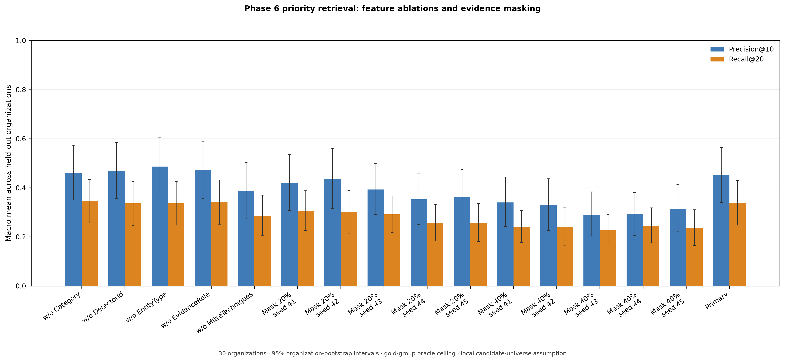
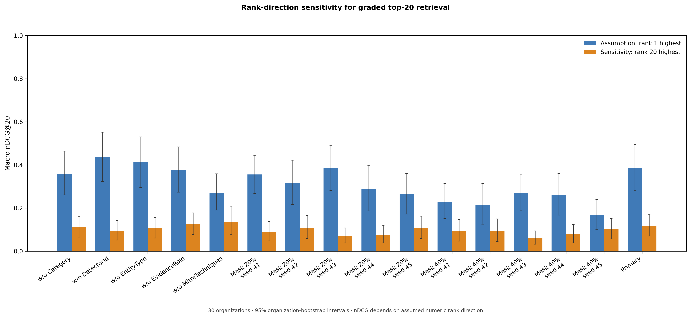

# Phase 6 priority retrieval — assumption-based local result

> **Historical output:** these metrics break equal-score ties by opaque candidate-key order. Use the [tie-aware exploratory re-analysis](tie_aware/report.md) for interpretation; the scorer and prediction files are unchanged.

**Classification:** `assumption_based_local_empirical_oracle_group_ceiling`  
**Held-out organizations:** 30  
**Local candidates:** 14,139  
**Expert top-20 labels:** 600

## Results

| Condition | P@10 mean [95% CI] | Recall@20 mean [95% CI] | nDCG@20 (rank 1 highest) | nDCG@20 (rank 20 highest) |
|---|---:|---:|---:|---:|
| leave_out_Category | 0.4600 [0.3500, 0.5733] | 0.3450 [0.2567, 0.4333] | 0.3593 | 0.1109 |
| leave_out_DetectorId | 0.4700 [0.3567, 0.5833] | 0.3367 [0.2467, 0.4267] | 0.4373 | 0.0944 |
| leave_out_EntityType | 0.4867 [0.3667, 0.6067] | 0.3367 [0.2483, 0.4267] | 0.4121 | 0.1081 |
| leave_out_EvidenceRole | 0.4733 [0.3567, 0.5900] | 0.3417 [0.2517, 0.4317] | 0.3768 | 0.1256 |
| leave_out_MitreTechniques | 0.3867 [0.2733, 0.5033] | 0.2867 [0.2067, 0.3700] | 0.2719 | 0.1370 |
| mask_20_seed_41 | 0.4200 [0.3067, 0.5367] | 0.3067 [0.2250, 0.3900] | 0.3560 | 0.0895 |
| mask_20_seed_42 | 0.4367 [0.3167, 0.5600] | 0.3000 [0.2150, 0.3883] | 0.3181 | 0.1079 |
| mask_20_seed_43 | 0.3933 [0.2900, 0.5000] | 0.2917 [0.2167, 0.3667] | 0.3850 | 0.0717 |
| mask_20_seed_44 | 0.3533 [0.2500, 0.4567] | 0.2583 [0.1833, 0.3317] | 0.2895 | 0.0763 |
| mask_20_seed_45 | 0.3633 [0.2567, 0.4733] | 0.2583 [0.1800, 0.3367] | 0.2635 | 0.1087 |
| mask_40_seed_41 | 0.3400 [0.2433, 0.4433] | 0.2417 [0.1767, 0.3083] | 0.2291 | 0.0939 |
| mask_40_seed_42 | 0.3300 [0.2267, 0.4367] | 0.2400 [0.1633, 0.3183] | 0.2139 | 0.0924 |
| mask_40_seed_43 | 0.2900 [0.2033, 0.3833] | 0.2283 [0.1667, 0.2917] | 0.2704 | 0.0611 |
| mask_40_seed_44 | 0.2933 [0.2067, 0.3800] | 0.2450 [0.1750, 0.3183] | 0.2594 | 0.0780 |
| mask_40_seed_45 | 0.3133 [0.2200, 0.4133] | 0.2367 [0.1650, 0.3100] | 0.1680 | 0.1009 |
| primary | 0.4533 [0.3400, 0.5633] | 0.3383 [0.2483, 0.4283] | 0.3861 | 0.1181 |

## Interpretation and limits

Candidates are formed using gold `IncidentId` groups. Results are therefore a prioritization ceiling conditional on correct grouping; they are not end-to-end system performance. The BM25 exemplar corpus uses only pilot/development top-20 examples. Test QueueRank values were read only after prediction, configuration, code, split, and candidate-universe hashes were frozen.

The local candidate universe is all distinct GUIDE composite incidents in the frozen test organizations, a project assumption because the local file has no `Split` or active-queue snapshot. `QueueRank=1` is assumed highest for the primary nDCG; the opposite convention is reported as a sensitivity analysis. P@10 and Recall@20 use only the complete top-20 membership set and do not depend on rank direction.

Only `DetectorId`, `Category`, `MitreTechniques`, `EntityType`, and `EvidenceRole` are model-visible. Conflicting alert keys and their evidence were excluded. The run is offline, with no live model or external API calls. No correlation, joint-system, severity-baseline, or LLM claim is made.

Robustness conditions independently mask 20% and 40% of descriptor tokens under five fixed seeds. Field ablations remove one descriptor family at a time. Paired differences use organization-level bootstrap intervals; no significance tests are reported.

## Figures

