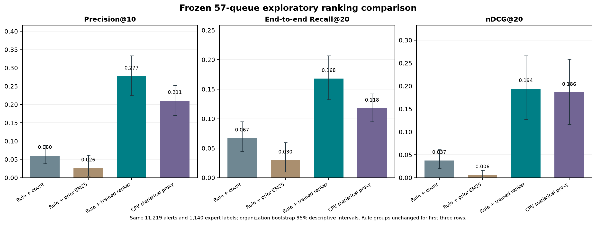

# Exploratory performance iteration: frozen ranker transfer

**Status:** completed local experiment; not a confirmatory publication result. The existing `FINAL_REPORT.md` and report PDF were **not edited for this iteration**. The new prediction and evaluation are versioned and separate from prior runs.

## Question and method

The earlier 57-queue matched offline comparison showed weak Recall@20 with rule/count, rule/BM25, and statistical CP/CPV proxies. This iteration asks whether a ranker fitted on **different organizations** can improve priority ordering without changing candidate pairs, correlation decisions, predicted groups, or expert-label denominators.

The [trained logistic model](../outputs/submission_trained_ranker_20261114_v1/run_manifest.json) was fitted on 334 historical training organizations using only alert-count, local BM25-like score, their within-queue positions, and group-count features. All 57 organizations in this transfer study are marked `holdout` in the historical split and are disjoint from those 334 training organizations. The transfer [prediction code](../src/submission_transfer_ranker.py) verified the frozen model and parent prediction hashes, rescanned GUIDE_Test for the five local-only descriptors, scored the **unchanged** rule, CP, and CPV predicted groups, and froze scores before the separate evaluator opened those 57 organizations' membership and expert ranks. It used no local or hosted LLM calls. The 57 organizations and their labels had already been evaluated earlier in this project; the method choice also followed earlier exposure, so this is exploratory despite the within-run organization split.

The matched table below re-evaluates every row with the same tie-aware 80%-completeness/80%-purity recovery rule, rank-1-highest local assumption, and all **1,140 expert top-20 labels**. The cohort contains **11,219 unambiguous alerts** and **1,216,600 frozen candidate pairs**. The [aggregate metrics](../outputs/submission_transfer_ranker_20261114_v1/metrics.json), [prediction freeze](../outputs/submission_transfer_ranker_20261114_v1/prediction_freeze.json), and [run manifest](../outputs/submission_transfer_ranker_20261114_v1/run_manifest.json) supply exact hashes and denominators.

## Matched results

| Method on the same 57 queues | Predicted groups | Pair F1 micro | P@10 macro | End-to-end Recall@20 macro | nDCG@20 macro, rank 1 high |
|---|---|---:|---:|---:|---:|
| Rule/count | Rule | 0.1364 | 0.0604 | 0.0670 | 0.0374 |
| Rule/previous BM25 | Rule | 0.1364 | 0.0262 | 0.0296 | 0.0061 |
| **Rule/transferred trained ranker** | **Rule** | **0.1364** | **0.2772** | **0.1678** | **0.1940** |
| Statistical CPV proxy/original ranker | CPV | 0.0872 | 0.2105 | 0.1175 | 0.1859 |
| Statistical CPV proxy/transferred ranker | CPV | 0.0872 | 0.2140 | 0.1184 | 0.1860 |

The strongest transfer row reorders the **same rule groups** as B0 and B1; its pair TP/FP/FN stay **12,842/127,914/34,765**. It improves ranking, not correlation. CPV uses different groups, so its pair F1 differs. The CP/CPV methods are offline statistical proxies, **not** empirical multi-agent LLM results. The previously reported `offline_joint_v2` table used a different tie handling for some rows; this table recomputes all comparators under the same tie-aware evaluator rather than mixing published numbers from different metric rules.



**Figure 1.** P@10, end-to-end Recall@20, and rank-1-high nDCG@20 for the matched cohort. Error bars are descriptive 95% organization-bootstrap intervals; the [figure manifest](figures/transfer_ranker_57_manifest.json) records aggregate-input and output hashes. The first three methods share rule grouping and therefore have the same pair F1.

The [additive paired analysis](../outputs/submission_transfer_ranker_20261114_v1/paired_analysis.json) reports 10,000-resample **organization-bootstrap** differences. Rule/transferred minus rule/count Recall@20 is **+0.1009** [0.0739, 0.1308]; P@10 is **+0.2168** [0.1705, 0.2668]. Against the existing CPV proxy, Recall@20 is **+0.0503** [0.0219, 0.0820] and P@10 **+0.0667** [0.0263, 0.1088]. These intervals describe variation across these 57 exposed organizations. They do not correct the earlier label exposure or support a confirmatory p-value.

## Interpretation for the paper

This is a useful **new offline ranking baseline**: a model trained on separate organizations can substantially improve top-20 ordering of the same predicted rule components in this exploratory cohort. It does not show that the proposed C/P/V architecture is better than a single model, and it does not improve the candidate route, pair F1, verification quality, or live SOC performance. The 57-queue result must not be compared directly with the full-499 baseline or the 20-queue local-Qwen diagnostic because their cohorts, candidates, or scoring tasks differ. The Phase 2 requirement for complete matched B0–B4 and three-seed C/P/V comparisons remains open.

All 57 labels were previously accessed, the method family was selected after earlier outcomes were known, the official model-field allowlist is empty, and rank direction and active-queue semantics remain assumptions. The **95% Recall@20 target is not achieved**. For a publishable confirmatory superiority claim, freeze a method and evaluation contract before obtaining an independent untouched labeled cohort. Use the existing study to motivate that future test, not as evidence of generalization.

## Reproduce

From the repository root, use a **new run ID**; recorded outputs refuse overwriting:

```powershell
.\.venv\Scripts\python.exe -m src.submission_transfer_ranker predict --run-id submission_transfer_ranker_NEW_ID
.\.venv\Scripts\python.exe -m src.submission_transfer_ranker evaluate --run-id submission_transfer_ranker_NEW_ID
.\.venv\Scripts\python.exe -m submission.verify_run_manifests submission_transfer_ranker_NEW_ID
```

The [paired-analysis script](analyze_transfer_ranker.py) reads frozen predictions and evaluator truth and writes aggregate differences only. Its fixed recorded output path is already occupied; reproduce in a separate checkout or adapt to a new versioned output path. Raw data, restricted prediction rows, and fitted model weights remain outside public `outputs/`.
