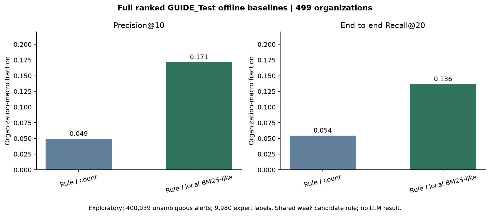

# Phase 3 implementation report: GUIDE_Test hybrid evaluation

**Prepared:** 2026-11-13. **Status:** exploratory implementation and evaluation. The raw GUIDE_Test export is retrospective SOC research data, not a live SOC feed. This report separates the full offline run, a bounded local Qwen model run, and the fictional dashboard simulation.

## Abstract

This project implements alert correlation, group prioritization, and evidence review for the Microsoft GUIDE research export. A full offline pass covers 4,147,992 evidence rows and the 499 ranked organizations, while a bounded local `qwen2.5:3b` pass exercises C/P/V roles and single-model pair baselines on frozen candidate pairs. Predictions were frozen before evaluator truth was opened. The full offline result exposes a severe candidate-retrieval bottleneck: 37,018 of 159,186,107 positive alert pairs reached the candidate set. The work demonstrates a reproducible pipeline and local model integration; it does not establish the proposed performance target or a confirmatory advantage over baselines.

## Problem, method, and data

The research question is whether a correlate–prioritize–verify (C/P/V) workflow can group related alerts and recover expert-prioritized incidents. The supplied `GUIDE_Test.csv` is an evidence-row export; multiple rows can describe one alert. Its queue file has 499 organizations and 20 expert labels per organization. The project uses `(OrgId, AlertId)` and `(OrgId, IncidentId)` composite identities. All 70,702 conflicting alert keys are excluded from model and offline truth scoring while all expert labels remain in end-to-end denominators. The five descriptor fields are local-only assumptions; the official field allowlist remains empty. Time, raw entity identifiers, and external model transmission remain outside the approved field boundary. The [data and claim audit](DATA_AND_CLAIM_AUDIT.md) documents these constraints.

The related [GUIDE study](https://arxiv.org/abs/2407.09017) supplies the investigation and triage data context; the [Adaptive Incident Prioritization study](https://arxiv.org/abs/2607.16963) concerns queue-relative expert priority. This implementation examines a further gap: recovery of ranked incidents from **predicted alert groups** when alert membership itself is ambiguous. Its local exported queue and field semantics do not exactly reproduce the published active-queue task, so published headline results are background rather than direct benchmark rows.

The proposed design combines candidate generation, a C correlation decision, P group priority, and V citation review. The implementation here has two explicitly different scopes. The [full offline pipeline](../src/submission_full_guide.py) scans all GUIDE_Test evidence, applies an exact category plus ATT&CK-technique candidate rule, groups linked alerts, and compares a count ranker with a label-free local BM25-like ranker. The [local Qwen pipeline](../src/submission_local_qwen.py) uses previously frozen correlation candidates in two deterministic small queues, with 15 score-stratified pairs per queue. It runs C, a single-call B2 pair decision, three-call B3 majority pair decisions, P, and V through localhost Ollama. This is a batched model prototype, not the complete proposed pair-by-pair protocol. B2 and B3 have pair scores only; there is no matched B4 model run or complete component-ranking comparison.

Both pipelines split prediction and evaluation. The prediction stages use local descriptors and frozen candidate data. Evaluators alone read incident membership and queue ranks after prediction files and hashes are written. This separation prevents an accidental label join during inference; it does not create an untouched test set because the data and labels were previously accessed. The full offline and Qwen cohorts and candidate policies differ, so their scores must not be compared as a paired model contest.

## Phase 1–4 implementation status

| Phase | Implementation evidence | Evaluation status |
|---|---|---|
| 1 — Data validation | [Dataset audit](DATA_AND_CLAIM_AUDIT.md) and [Phase 1 record](../phases_outputs/Phase1.md) cover schema, evidence-row grain, composite keys, queue joins, and conflicts. | Local real-data validation. |
| 2 — Preprocessing | [Phase 2 record](../phases_outputs/Phase2.md) covers stable source ordinals, restricted evidence ledger, evaluator-only labels, and deny-by-default export. | Ran on real local files; field and split gates remain provisional. |
| 3 — Baselines | [Phase 3 record](../phases_outputs/Phase3.md) documents rule/BM25 and single-model orchestration. The new full offline and bounded local-Qwen artifacts extend empirical coverage. | Earlier B2/B3 checks were synthetic; the new B2/B3 results are local model pair diagnostics only. |
| 4 — C/P/V agents | [Phase 4 record](../phases_outputs/Phase4.md) documents schema and citation plumbing; [MVP runner](MVP_SYNTHETIC_RUN.md) exercises the offline workflow. The new local Qwen prototype exercises batched C/P/V on GUIDE descriptors. | Earlier agent checks were synthetic; the new two-queue model evaluation is exploratory. |

The Phase 5 evaluator supplies the isolated metric functions and the Phase 6 dashboard supplies an aggregate viewer and a distinct fictional simulation. The planned full empirical LLM C/P/V study is still incomplete.

## Experimental setup

Both new runs use the supplied retrospective GUIDE_Test export and versioned output paths. The full offline pass evaluates all 499 ranked organizations after ambiguous-key exclusion and compares two rankers on exactly the same rule-generated groups. The bounded Qwen pass uses two deterministic organizations from a previously accessed holdout, with 10 highest-score and 5 lowest-score prior frozen candidate pairs in each. Selection was label-blind, but this is a convenience sample. The local model is pinned by its Ollama digest and called with fixed seeds; C, B2, and B3 decide pairs, then P and V operate on C groups. The [reproduction guide](REPRODUCE.md) lists commands, source hashes, and output paths. There is no prospective SOC stream, fresh test split, matched full-model budget, or analyst adjudication.

## Full GUIDE_Test offline results

The [full-run metrics](../outputs/submission_full_guide_20261112_v1/metrics.json), [prediction freeze](../outputs/submission_full_guide_20261112_v1/prediction_freeze.json), and [run manifest](../outputs/submission_full_guide_20261112_v1/run_manifest.json) record 499 ranked organizations, 400,039 unambiguous alerts, 314,576 generated candidates, 3,517,608,736 possible within-queue pairs, 159,186,107 positive pairs, and 9,980 expert top-20 labels. The 656,408 evidence rows attached to ambiguous keys in those organizations were omitted from prediction; the complete raw input contains 4,147,992 evidence rows. Only 9,125 of the 9,980 expert labels have unambiguous in-scope alert evidence under this rule, a structural coverage ceiling rather than measured recall. All 9,980 remain in the end-to-end denominator.

Candidate recall was **37,018 / 159,186,107 = 0.0233%**, at **314,576 / 3,517,608,736 = 0.00894%** pair coverage. The rule trades an extremely small pair workload for catastrophic recall. It fails the project's 99% candidate-recall target. Both offline rankers share the same grouping, so their micro pair F1 is **0.00910**. Their ranking differs:

| Method | P@10, organization macro | End-to-end Recall@20, organization macro | nDCG@20, rank 1 high |
|---|---:|---:|---:|
| Rule / count | 0.0492 | 0.0543 | 0.0364 |
| Rule / local BM25-like | 0.1714 | 0.1364 | 0.1542 |

The manifest supplies 10,000-resample organization-bootstrap intervals. For BM25-like Recall@20 the descriptive interval is [0.1244, 0.1488]. Scores use a local query universe and rank-1-highest assumption; the metrics also retain reverse-direction sensitivity. Equal-score blocks use expected tie-aware ranking. None of these intervals repairs the selection or protocol limitations.

**Figure 4.** Aggregate-only view of two rankers sharing the same weak candidate grouping. [Figure source and output hashes](figures/submission_figure_manifest.json).

## Bounded local Qwen evaluation

The Qwen results and exact call counts appear in [the local model metrics](../outputs/submission_qwen_20261112_v1/metrics.json), [prediction freeze](../outputs/submission_qwen_20261112_v1/prediction_freeze.json), [run manifest](../outputs/submission_qwen_20261112_v1/run_manifest.json), and [full-membership correction](../outputs/submission_qwen_20261112_v1/metrics_full_membership_correction.json). The selected sample consists of two already accessed organizations, 15 frozen candidate pairs per organization, and 40 expert labels kept in the end-to-end denominator. Pair decisions use descriptor evidence references; invalid or absent citations become abstentions or review cases. P scores are relative and uncalibrated. V checks cited support over the supplied local descriptors and has no independent human adjudication or revision loop. The two-org sample does not support a confidence interval or generalization to the full GUIDE_Test set.

<!-- QWEN_RESULTS_START -->
The local Ollama model was `qwen2.5:3b`, digest `357c53fb659c5076de1d65ccb0b397446227b71a42be9d1603d46168015c9e4b`. The frozen run made **34 localhost calls**, with **19,353 prompt tokens**, **7,842 output tokens**, **zero failed calls**, and zero hosted calls. It covered **32 selected alerts** from two organizations and **30 selected candidate pairs**. The label-blind score-stratified selection contained **zero positive pairs**, so positive-pair recall and F1 cannot be estimated from this sample. C predicted no false positive links and abstained on 3 pairs; B2 predicted no false positive links and abstained on 2; B3 majority predicted one false positive link and abstained on 3. These are small negative-pair diagnostics, not evidence that C or B2 is superior.

The batched C output left **32 singleton groups**. The evaluator initially calculated incident completeness using only those 32 selected alerts. A separate additive [correction](../outputs/submission_qwen_20261112_v1/correction_manifest.json) checks completeness against **all 455 unambiguous alerts in the two organizations** while preserving the frozen predictions and original metric file. It still finds **11/40 expert labels recovered**, an organization-macro Recall@20 of **0.275**, and P@10 of **0.45**; 37/40 labels have any unambiguous alert in these organizations. Because the groups are singletons and the sample was deliberately limited, this is mainly recovery of single-alert incidents, not demonstrated Qwen correlation ability. The review flag covers 67.1% of predicted groups. Rank-1-highest nDCG@20 is 0.00983 under the local rank-direction assumption. No direct full-offline-versus-Qwen ranking comparison is valid.
<!-- QWEN_RESULTS_END -->

## Baselines, ablations, and earlier evidence

The prior [matched offline proxy analysis](RESULTS_AND_DISCUSSION.md) reports four methods on the same 57 small queues and 1,140 labels. Its offline CP and CPV scores are statistical proxies, not LLM measurements. Earlier oracle-group feature removal and masking measure a separate conditional priority task; the `MitreTechniques` omission reduced oracle-group Recall@20 from 0.3392 to 0.2897 on 30 previously exposed queues. Those figures are useful context but cannot be pooled with this full-run result or the bounded Qwen run. The [experiment register](EXPERIMENT_REGISTER.md) traces method names, cohorts, and unavailable comparisons.

## Error analysis and discussion

The dominant full-run error occurs before model inference: exact category plus technique matching omits more than 159 million positive pairs. Pair grouping consequently reaches only a small fraction of incident membership, and ranking cannot recover omitted groups. BM25-like ranking helps order the limited predicted components but does not cure candidate omission. A broader candidate generator with measured recall and a controlled workload is required before the original target can be evaluated. The Qwen sample tests local model plumbing and evidence formatting; its selected pairs, small cohorts, and uncalibrated P scores cannot establish an operational improvement.

A later [post-hoc route diagnostic](../outputs/recall_route_diagnostic_20261113_v1/aggregate.json) on the previously exposed 57 small queues examined exact descriptor overlap without neighbor caps. The union of shared `Category`, `MitreTechniques`, or `DetectorId` reached **47.72% of positive pairs** while covering **59.45% of all pairs**. This truth-informed diagnostic is not a frozen candidate benchmark or a model result. It shows that raising the neighbor cap on these exact fields alone is not a supported path to the 99% candidate target.

The original proposed B0 detector-severity baseline is unavailable because severity is absent. The full offline rule/count baseline is an amendment. The B2/B3 local model runs are pair-only diagnostics; B4 and complete matched C/P/V baselines with equal candidate, evidence, and token budgets remain unavailable. Ambiguous membership, exact queue semantics, rank direction, field timing/privacy approval, fresh evaluation data, analyst judgments, latency, and cost remain unresolved. Only **9,125/9,980 = 91.43%** of full-run top-20 labels have unambiguous in-scope alert evidence; even perfect predictions cannot reach 95% end-to-end recovery under the current exclusion policy. The [known limitations](KNOWN_LIMITATIONS.md) list submission-relevant gaps.

## Dashboard and deliverables

The [aggregate research dashboard](../dashboard/index.html) reads saved metrics; the [fictional simulation](../dashboard/simulation.html) replays synthetic MVP events with Start, Pause, Reset, speed, and scenario controls. The simulation is not a GUIDE data or Qwen result viewer. Its [build manifest](../dashboard/simulation_manifest.json) and [documentation](../dashboard/SIMULATION_README.md) identify the trace and UI boundary. Reproduction commands are in [REPRODUCE.md](REPRODUCE.md); the [delivery checklist](DELIVERY_CHECKLIST.md) maps these artifacts to Phase 3 assignment requirements.

## Conclusion

The hybrid work is runnable and auditable, but the full-data offline rule misses the candidate-recall target by a wide margin, and the local Qwen study is deliberately bounded. The supported conclusion is implementation feasibility with substantial empirical and protocol gaps. No 95% success, confirmatory model gain, operational SOC readiness, or military certification claim is supported.

## References

- [Microsoft GUIDE dataset paper](https://arxiv.org/abs/2407.09017).
- [Adaptive Incident Prioritization paper](https://arxiv.org/abs/2607.16963).
- [Local research protocol and phase index](../PROJECT_CONTEXT.md).
