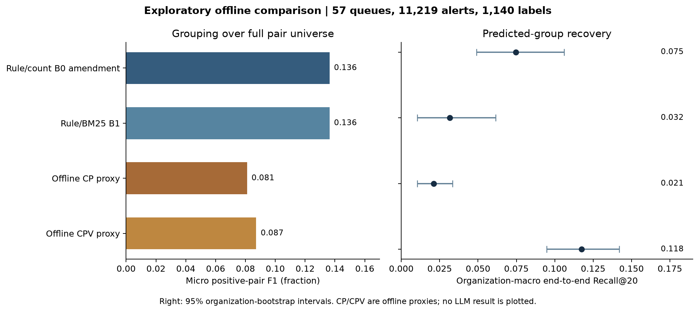
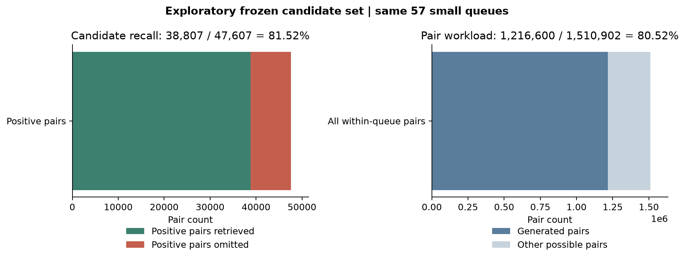
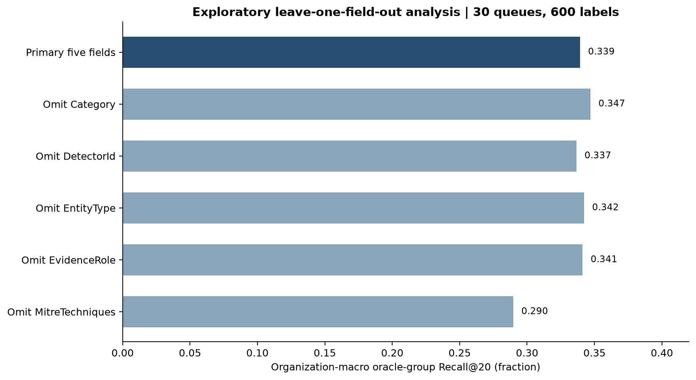

# Results and discussion

**Prepared:** 2026-11-12. **Evidence class:** exploratory local analyses plus a separately labeled synthetic software demonstration. This document interprets frozen aggregate artifacts; it adds no inference, evaluator access, metric definition, or test-set tuning. The [data and claim audit](DATA_AND_CLAIM_AUDIT.md) and [experiment register](EXPERIMENT_REGISTER.md) define the governing gates and method names.

## Scope and metric denominators

The main matched offline comparison uses 57 previously accessed GUIDE_Test organizations, 11,219 unambiguous alerts, 1,216,600 frozen candidate pairs, 1,510,902 possible within-organization pairs, and 1,140 expert top-20 labels. Every method in its [v2 metric artifact](../outputs/offline_joint_v2/metrics.json) uses the same cohort and evaluator denominator. The 70,702 conflicting alert keys in the full local dataset are excluded from correlation and joint scoring; excluded keys do not remove any top-20 label from the recall denominator. The comparison is bounded to queues with at most 500 unambiguous alerts, uses local-only assumed descriptors, and reuses an exposed cohort. It is not confirmatory.

| Measure | Unit, numerator/denominator, and interpretation | Aggregation and uncertainty |
|---|---|---|
| Candidate recall | Positive alert pairs in frozen candidate set / all 47,607 positive within-queue pairs on the 57-queue cohort. Measures retrieval before pair decisions. | Micro pooled ratio; no interval reported for the pooled ratio. The [candidate audit](../outputs/phase_a/candidate_20261111.json) separately gives a 10,000-resample organization-bootstrap interval for the organization macro mean. |
| Candidate pair coverage | 1,216,600 generated pairs / 1,510,902 possible within-queue pairs. Measures workload, not correctness. | Micro pooled ratio; no interval reported. |
| Pair precision/recall/F1 | From predicted components against the 57-queue full alert-pair universe. For rule grouping: TP 12,842, FP 127,914, FN 34,765. Positive pairs are same-incident pairs only among unambiguous in-scope alerts. | Table below uses micro pooled values. The source JSON also has organization-macro means and 10,000-resample organization-bootstrap intervals; pairs are not independent sampling units. |
| Precision@10 | Recovered expert incidents in the first ten predicted components / ten per queue. | Organization macro mean; source JSON has 10,000-resample organization-bootstrap intervals. |
| End-to-end Recall@20 | Expert top-20 incidents recovered by a predicted top-20 component meeting both 80% completeness and 80% purity / **20 labels per queue**, 1,140 total. Missing in-scope incident evidence gives zero recovery. | Organization macro mean; 95% organization-bootstrap intervals from 10,000 resamples. The label denominator stays unchanged. |
| nDCG@20 | Graded priority among predicted components against ranked top-20 judgments, using gain `2^(21-r)-1` for judged ranks. Numeric rank 1 highest is an assumption; reverse-direction values are retained in the artifact. | Organization macro mean; 95% organization-bootstrap intervals. Unranked incidents have no graded negative judgment. |

The top-20 *set* measures use the locally reported expert top-20 labels and treat other candidates as nonmembers for set retrieval only. They do not assign negative severity or a graded score to every unranked incident. Queue rank direction and the exact publisher active-queue snapshot remain unresolved. [Metric amendments](../phases_outputs/metric_tie_amendment.md) govern tie-aware oracle-group reporting; the v2 predicted-group metrics and their definitions are in the frozen artifact.

## Matched predicted-group comparison

| Method on the same 57 queues | Pair precision micro | Pair recall micro | Pair F1 micro | P@10 macro | End-to-end Recall@20 macro [95% CI] | nDCG@20 macro, rank 1 high |
|---|---:|---:|---:|---:|---:|---:|
| Amended B0 rule/count | 0.0912 | 0.2698 | 0.1364 | 0.0684 | 0.0746 [0.0491, 0.1061] | 0.0364 |
| B1 rule/BM25 | 0.0912 | 0.2698 | 0.1364 | 0.0298 | 0.0316 [0.0105, 0.0614] | 0.0062 |
| Offline CP proxy | 0.0458 | 0.3555 | 0.0811 | 0.0421 | 0.0211 [0.0105, 0.0333] | 0.0395 |
| Offline CPV proxy | 0.0513 | 0.2923 | 0.0872 | 0.2105 | 0.1175 [0.0947, 0.1421] | 0.1859 |

The [v2 run](../outputs/offline_joint_v2/run_manifest.json) has the same alert set, candidate pairs, and 1,140-label denominator for all rows. B0 is an explicit **count-ranking amendment** because detector severity is unavailable. B1 shares B0's rule grouping but changes ranking, explaining their identical pair metrics. CP and CPV are deterministic/statistical offline proxies; their verifier-like filter checks descriptor agreement, not citation truth. They are not B4 or the proposed LLM C/P/V. This comparison lacks matched LLM evidence/token budgets. B2, B3, empirical B4, and empirical LLM C/P/V have no scores. The observed proxy ordering is descriptive on a previously accessed, selected cohort and cannot establish LLM-agent superiority.



**Figure 1.** Left: micro positive-pair F1 over the full in-scope pair universe; right: organization-macro predicted-group end-to-end Recall@20, with 95% organization-bootstrap intervals. Four methods share 57 queues, 11,219 alerts, 1,216,600 candidate pairs, and all 1,140 expert labels. The two panels are different metrics with different aggregation; no LLM result is plotted. Source: [v2 metrics](../outputs/offline_joint_v2/metrics.json).

## Candidate losses and errors

The [same-cohort candidate audit](../outputs/phase_a/candidate_20261111.json) found 38,807/47,607 positive pairs in the frozen candidate set, for **81.52% micro candidate recall**. The 8,800 missing positives were unavailable to any downstream pair classifier. Generating 1,216,600/1,510,902 possible pairs covered **80.52% of the pair workload** yet missed those positives; the Phase A 99% candidate-recall target was not met. Its organization-macro candidate recall was 98.12% (95% organization-bootstrap interval 96.00–99.70%, 10,000 resamples), illustrating why the pooled and macro summaries should both be shown. This candidate metric is separate from the pair-classification recall and final recovered-incident recall above.



**Figure 2.** Left denominator: 47,607 positive pairs; 38,807 retrieved and 8,800 omitted. Right denominator: 1,510,902 possible within-queue pairs; 1,216,600 generated. The panels use separate count scales. Same 57 exploratory queues as Figure 1. Source: [Phase A candidate audit](../outputs/phase_a/candidate_20261111.json).

The [aggregate miss audit](../outputs/phase_a/missed_positive_pairs_20261111.json) examined all 8,800 omitted positive pairs. Its generic descriptor overlap did not provide a selective new route; Phase A's later local entity/title routes raised validation micro recall only from 80.13% to 80.37% at about 67% pair coverage on a **different 67-organization validation cohort**. Those two candidate studies cannot be pooled. The [coverage audit](../outputs/phase_a/coverage_20261111.json) found 74/1,140 expert labels represented only by ambiguous alerts in the 57-queue joint cohort. Under the current exclusion rule, at most 1,066/1,140 = **93.51%** of labels could be recovered, even with perfect predictions. This is a structural ceiling, not a measured model result, and the 74 remain in the reported denominator.

The separate [Phase 6 correlation diagnostic](../outputs/phase6/correlation/phase6-correlation-20261108-v1/evaluation/corrected/metrics.json) used 30 organizations and 30,692 unambiguous alerts. Its micro full-positive-pair recall was 0.00845 over 6,142,793 positive pairs; candidate coverage was 194,296/67,048,813 possible pairs = 0.00290. The corrected report gives mean per-organization clustering diagnostics of 4.97 false merges and 50.47 false splits. This narrow technique-overlap diagnostic is not a paired baseline for Figure 1. For the v2 joint cohort, pair FP/FN counts are available, but reviewed, categorized false-merge/split annotations are not. No blinded two-reviewer error labeling was performed, so there is no supported claim about citation support or analyst benefit.

## Oracle-group ablation and masking: a different task

The earlier [tie-aware Phase 6 priority analysis](../outputs/phase6/priority/phase6-priority-20261108-v2/evaluation/tie_aware/metrics.json) ranks **gold incident groups**, using 30 previously exposed organizations, 14,139 local candidate incidents, and 600 top-20 labels. Its primary organization-macro Recall@20 was 0.3392 (95% organization-bootstrap interval 0.2492–0.4284; 10,000 resamples). This is conditional ranking with oracle groups, not end-to-end recovery. The primary P@10 was 0.4622; nDCG@20 was 0.3924 if rank 1 is highest and 0.1153 under the reverse-direction sensitivity. Ties at the top-20 cutoff affected 497/600 slots; the tie-aware amendment takes expected values over tied score blocks.



**Figure 3.** Organization-macro oracle-group Recall@20 for the frozen five-field scorer and five leave-one-field-out conditions, over the same 30 exposed queues and all 600 labels. Omitting `MitreTechniques` gave 0.2897 versus 0.3392 for the primary condition. These local-only assumed fields lack independent point-in-time/privacy approval; the plot does not establish causal feature importance or end-to-end performance. Source: [tie-aware metrics](../outputs/phase6/priority/phase6-priority-20261108-v2/evaluation/tie_aware/metrics.json).

The [Phase 6 report](../phases_outputs/Phase6.md) records five fixed masking seeds for each of 20% and 40% descriptor-token removal. Across those five seed summaries, mean oracle-group Recall@20 was 0.2820 and 0.2391, respectively, versus 0.3392 primary. These perturbations reuse the exposed cohort. They describe sensitivity of this offline priority ranker under the specified masking procedure; they do not measure robustness of the proposed LLM C/P/V system. The reported paired organization-bootstrap interval for the leave-`MitreTechniques`-out Recall@20 difference was [-0.0823, -0.0204]. The project record treats this as descriptive exploratory analysis and reports no confirmatory p-value.

## Relation to published work

The [Microsoft GUIDE paper](https://arxiv.org/abs/2407.09017) introduces a large incident/evidence dataset in the context of guided response, including investigation, triage, and remediation. The [Adaptive Incident Prioritization paper](https://arxiv.org/abs/2607.16963) describes queue-relative incident prioritization and an expert-ranked 499-organization extension. This project asks an additional question: whether predicted alert groups can support ranked incident recovery under ambiguous membership, then whether an LLM C/P/V workflow improves that process. The local exported `QueueRank` file and grouping semantics do not fully reconstruct the paper's active-queue setting. Published deployment or expert-review headline numbers, and this project's oracle-group or predicted-group metrics, have different tasks, inputs, and denominators; none is used as a direct win/loss comparison here.

## Software demonstration only

The [MVP synthetic record](MVP_SYNTHETIC_RUN.md) and [fictional run metrics](../outputs/mvp/mvp-demo-20261112-v2/metrics.json) exercise a one-command offline workflow on 12 hand-authored alerts. The fixture intentionally includes false merges and review routing. Its numbers are **software checks**, not GUIDE results, LLM performance, or a research ablation. No value from that run appears in Figures 1–3 or the empirical tables above. Its dashboard event trace is for a later simulated interface task only.

## Reproduce the figures

From the repository root, with the existing project environment:

```powershell
.\.venv\Scripts\python.exe -m submission.generate_figures
```

The [figure script](generate_figures.py) reads only aggregate JSON from `outputs/offline_joint_v2/metrics.json`, `outputs/phase_a/candidate_20261111.json`, and `outputs/phase6/priority/phase6-priority-20261108-v2/evaluation/tie_aware/metrics.json`. It verifies the v2 run-manifest hashes of its tracked aggregate inputs/code and checks that the candidate audit cites the same frozen prediction hash. It writes three PNGs and a [figure manifest](figures/figure_manifest.json) with source/output SHA-256 values to `submission/figures/`. It never opens raw evidence, restricted prediction rows, evaluator labels, or MVP dashboard events. No new experiment output or metric is produced.

## Conclusion and remaining work

### 2026-11-13 hybrid implementation addendum

The later [Phase 3 hybrid report](FINAL_REPORT.md) records a distinct 499-organization full GUIDE_Test offline run and a bounded two-organization local `qwen2.5:3b` evaluation. They use different candidate designs and denominators from this Task 5 analysis and from each other. The full offline rule retrieved only 37,018/159,186,107 positive pairs, so candidate generation remained the limiting stage; its count and local BM25-like end-to-end Recall@20 were 0.0543 and 0.1364, respectively. The [new aggregate figure](figures/full_guide_offline.png) visualizes their ranking results. See the [full metrics](../outputs/submission_full_guide_20261112_v1/metrics.json), [local model metrics](../outputs/submission_qwen_20261112_v1/metrics.json), and [known limits](KNOWN_LIMITATIONS.md) before citing a result. These are exploratory additions; Figures 1–3 and the historical Task 5 tables are unchanged.


The strongest comparable local result is a **bounded exploratory proxy comparison**, not an empirical LLM C/P/V test. Its pair F1 and end-to-end recall values are low, candidate retrieval missed 8,800 positive pairs, and the 95% end-to-end target was not reached. The 93.51% exclusion-policy ceiling on this selected cohort further shows why the current rule cannot support that target without a source-validated membership policy. Queue mapping, rank direction, feature timing/privacy approval, untouched evaluation data, matched real-model methods, reviewer judgments, latency, and cost remain unresolved or unmeasured. These limits should accompany any use of the figures.

## Task 5 completion record

Created this document, `submission/generate_figures.py`, three PNGs under `submission/figures/`, and `submission/figures/figure_manifest.json`. No historical artifact or research behavior changed. `.\.venv\Scripts\python.exe -m submission.generate_figures` completed successfully; a local link check found 24 links and zero broken paths; all three generated PNG hashes matched the figure manifest; `git diff --check` passed. The three figures were visually inspected for readable titles, axes, labels, and exploratory scope. The synthetic MVP's event trace and answer key were not read by figure generation.
